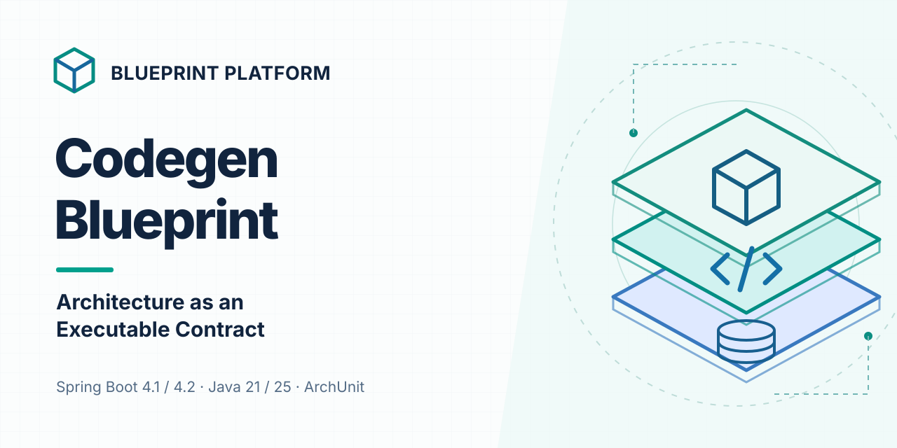

<h1 align="center">Codegen Blueprint</h1>

<p align="center"><strong>Architecture as an Executable Contract</strong></p>

<p align="center">
  <a href="https://github.com/blueprint-platform/codegen-blueprint/actions/workflows/build.yml?query=branch%3Amain"></a>
  <a href="https://app.codecov.io/gh/blueprint-platform/codegen-blueprint/tree/main"></a>
</p>
<p align="center">
  <a href="docs/compatibility.md"></a>
  <a href="docs/compatibility.md"></a>
  <a href="LICENSE"></a>
</p>

<p align="center"></p>

Codegen Blueprint generates **Spring Boot projects whose Maven build checks the architecture you select**. Choose Standard or Hexagonal and run the generated Maven wrapper to enforce the selected boundaries with ArchUnit.

> **See the contract in action.** In the generated Standard sample, a controller-to-repository dependency compiles and fails ArchUnit. Removing it restores a passing Maven build. [See the single-case proof](#see-a-compiling-change-fail-verification).

[Quickstart](docs/quickstart.md) · [Documentation](docs/index.md) · [Executable proof](docs/examples/boundary-proof.md)

## Generate and verify a project

Use **JDK 25** and **Maven 3.9.16**. From the repository root, build the unreleased 2.0 snapshot and generate a Hexagonal project with Strict guardrails and a runnable HTTP sample.

```bash
mvn -B -ntp clean package
OUTPUT_DIR="$(mktemp -d)"

java -jar target/codegen-blueprint-2.0.0-SNAPSHOT.jar --cli springboot \
  --group-id com.example --artifact-id greeting --name Greeting \
  --description 'Greeting sample with executable architecture' \
  --package-name com.example.greeting --layout hexagonal \
  --guardrails strict --sample-code basic --target-dir "$OUTPUT_DIR"

cd "$OUTPUT_DIR/greeting"
sh ./mvnw -B -ntp clean verify
```

The output is a project directory and a sibling `greeting.zip`. Maven runs the generated architecture tests and the sample’s HTTP integration tests. See the [verified quickstart](docs/quickstart.md) for prerequisites and report locations.

## Choose the boundaries to enforce

- **Standard** (default) organizes each feature into controllers, services, repositories and domain types.
- **Hexagonal** routes inbound and outbound dependencies through application ports, keeps business types in the domain and wires implementations in bootstrap.

<p align="center"></p>

`basic` (default) checks core dependencies, package structure and cycles. `strict` retains those checks and adds layout-specific constraints, including REST signatures when MVC is present. `none` generates the layout without ArchUnit checks.

[Generated walkthroughs](docs/examples/generated-projects.md) · [Guardrails rulebook](docs/architecture/architecture-guardrails-rulebook.md)

## See a compiling change fail verification

**GREEN → RED → GREEN.** The generated Standard sample with Strict guardrails passes `clean verify`. The proof runner then adds this field and its import to `GreetingController`.

```java
private
    LoggingGreetingAuditRepository
        __archViolation = null;
```

The change compiles. Surefire reports a failure in the ArchUnit assertion `controllers_must_not_depend_on_repositories`. Removing the field and import makes the same Maven command pass again.

<p align="center"><a href="docs/examples/boundary-proof.md"></a></p>

[Reproduce this case or run all five scenarios](docs/examples/boundary-proof.md) · [Inspect the historical proof record](docs/examples/proof-2.0.txt)

## What makes 2.0 a major release

Codegen Blueprint **1.x already shipped executable architecture guardrails**. The unreleased 2.0 changes the generation contract. The generator runs on Boot **4.2.0** and requires **Java 25**. Generated projects target **Boot 4.1 or 4.2** with **Java 21 or 25**. The default is **Boot 4.2 / Java 25**.

Boot 3.x and 4.0 are outside the 2.0 target set. Pass a minor selector such as `--boot 4.1` and the generator pins the resolved patch in the output POM. Generation rejects an existing project directory or sibling ZIP.

[2.0 release notes](docs/release-notes.md) · [Compatibility and verification coverage](docs/compatibility.md) · [CLI reference](docs/cli.md)

[Architecture contract](docs/architecture/executable-architecture-contract.md) · [Contributing](CONTRIBUTING.md) · [MIT license](LICENSE)
