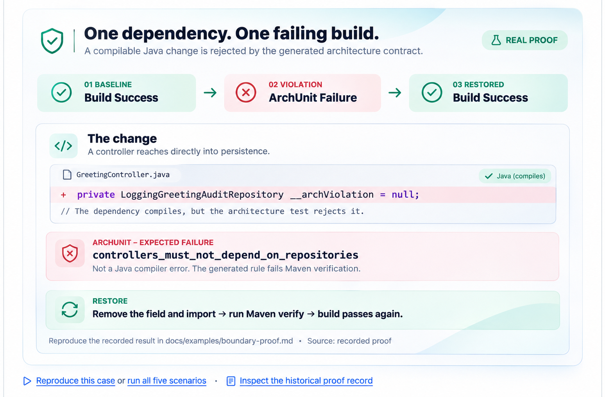

# Codegen Blueprint

[](https://github.com/blueprint-platform/codegen-blueprint/actions/workflows/build.yml?query=branch%3Amain) [](https://app.codecov.io/gh/blueprint-platform/codegen-blueprint/tree/main)

Generate a Spring Boot Maven project whose build enforces the architecture you select. Codegen Blueprint delivers the project directory and a sibling ZIP with the Maven wrapper and, by default, ArchUnit tests.

## Generate and verify a sample

Build the generator from the repository root with **JDK 25** and **Maven 3.9.16**.

```bash
mvn -B -ntp clean package
```

The [quickstart](docs/quickstart.md) takes that JAR through generation and wrapper verification. It runs the sample’s HTTP integration tests and checks the Hexagonal boundaries with Strict guardrails.

## See the build catch a boundary violation

The generated Standard sample uses Strict guardrails. A repository-typed field in `GreetingController` creates a dependency ArchUnit can detect in the compiled class.



[Inspect the Java change and named assertion, or reproduce the proof](docs/examples/boundary-proof.md).

## Choose a layout and guardrails

- **Standard** (default) gives each feature controller, service, repository and domain packages.
- **Hexagonal** gives use cases explicit ports and places framework wiring in bootstrap.

Choose `basic` for core dependency, package and cycle checks, `strict` for additional boundary checks, or `none` for structure alone. See the [guardrails rulebook](docs/architecture/architecture-guardrails-rulebook.md) for the exact checks in each mode.

[Documentation](docs/index.md) · [Contributing](CONTRIBUTING.md) · [MIT license](LICENSE)
