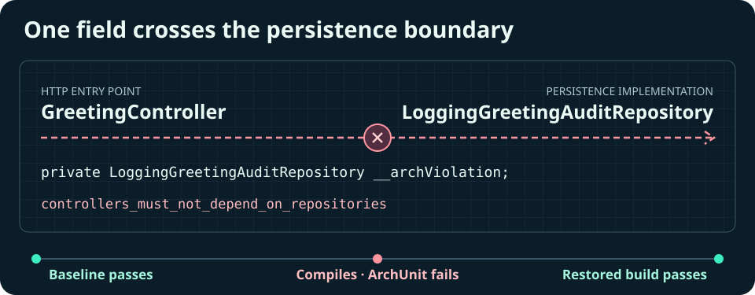

# Codegen Blueprint

[](docs/compatibility.md)
[](docs/compatibility.md)
[](LICENSE)

**Main branch**
[](https://github.com/blueprint-platform/codegen-blueprint/actions/workflows/build.yml?query=branch%3Amain)
[](https://app.codecov.io/gh/blueprint-platform/codegen-blueprint/tree/main)

**Architecture as an Executable Contract**

Generate a Java/Maven Spring Boot project with the layout, Maven wrapper and ArchUnit tests you select. A forbidden dependency can compile successfully and still fail the generated build at a named architecture rule.

**Generate → Enforce → Prove**

[Run the quickstart](docs/quickstart.md) · [Reproduce a boundary failure](docs/examples/boundary-proof.md) · [Explore the documentation](docs/index.md)

## What makes 2.0 a major release

Codegen Blueprint 1.x already shipped executable architecture guardrails. The unreleased **2.0** keeps that approach and changes the generation contract. The generator runs on Spring Boot **4.2.0** and requires **Java 25**. Generated projects target **Spring Boot 4.1 or 4.2** with **Java 21 or 25**, defaulting to **Boot 4.2 / Java 25**.

Use minor selectors such as `--boot 4.1`. The generator pins the resolved patch in the generated POM. Boot 3.x and 4.0 targets are removed, and generation fails if the target project directory or ZIP already exists.

[2.0 release notes](docs/release-notes.md) · [CLI reference](docs/cli.md)

## Try it from source

Use **JDK 25** and **Maven 3.9.16**. From the repository root, run `mvn -B -ntp clean package` to build the 2.0 snapshot, then generate into a fresh directory.

```bash
OUTPUT_DIR="$(mktemp -d)"
java -jar target/codegen-blueprint-2.0.0-SNAPSHOT.jar --cli springboot \
  --group-id com.example --artifact-id greeting --name Greeting \
  --description 'Greeting sample with executable architecture' \
  --package-name com.example.greeting --layout hexagonal \
  --guardrails strict --sample-code basic --target-dir "$OUTPUT_DIR"
```

The generator writes a project directory and a sibling ZIP. The [verified quickstart](docs/quickstart.md) builds that project with its own wrapper and shows where to find the architecture and sample HTTP test reports.

## Choose a layout and guardrails

| Layout | Package boundaries |
| --- | --- |
| **Standard** (default) | Controllers, services, repositories and domain types organize each feature. |
| **Hexagonal** | Inbound and outbound adapters use application ports. Business types live in the domain and bootstrap wires the components. |


Use `basic` (default) for core layout, package and cycle checks, `strict` for additional layout-specific checks including REST signatures when MVC is present, or `none` for the layout without generated ArchUnit checks. [Generated examples](docs/examples/generated-projects.md) · [Guardrails rulebook](docs/architecture/architecture-guardrails-rulebook.md)

## See the build catch a boundary violation

In the generated Standard sample, a field in `GreetingController` with type `LoggingGreetingAuditRepository` compiles. Maven verification fails at `controllers_must_not_depend_on_repositories`. Remove the field and import to restore the passing build.

[](docs/examples/boundary-proof.md)

[Run the proof](docs/examples/boundary-proof.md) · [Read the recorded results](docs/examples/proof-2.0.txt)

[Compatibility and verification coverage](docs/compatibility.md) · [Architecture contract](docs/architecture/executable-architecture-contract.md) · [Contributing](CONTRIBUTING.md)
