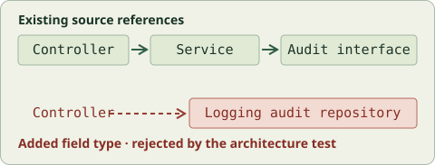

# Codegen Blueprint

**Generate a Spring Boot service whose build checks its architecture.**

A controller can reach directly into persistence and still compile. Its endpoint may even pass integration tests. The service boundary has changed anyway. Once a shortcut lands, the next contributor has to infer whether it was intentional.

Codegen Blueprint gives that decision a place in the project itself. Choose a **Standard** or **Hexagonal** layout and the generator writes the source structure, Maven build and selected ArchUnit tests into a project and a sibling ZIP. From the first commit onward, the project's own build can point to the dependency that crossed a boundary.

## See the compiler pass and the architecture fail

In a generated Standard service, the greeting controller delegates to a service. The proof adds an import for the concrete repository and a single field to `GreetingController`:

```java
private LoggingGreetingAuditRepository __archViolation = null;
```



The field is valid Java. During Surefire, the generated ArchUnit test rejects the bytecode dependency. The recorded 2.0 run names the rule:

```text
StandardStrictLayerDependencyRulesTest.controllers_must_not_depend_on_repositories
```

The assertion reports that `GreetingController.__archViolation` has type `LoggingGreetingAuditRepository`. Removing the import and field makes the build pass again. The full proof includes the exact Surefire output, the other four mutations and instructions to replay them. [Inspect GREEN → RED → GREEN](docs/examples/boundary-proof.md)

## Generate and verify a service

The 2.0 snapshot runs on **JDK 25**. Use **Maven 3.9.16** to package it from the repository root:

```bash
mvn -B -ntp clean package
```

The [quickstart](docs/quickstart.md) uses the resulting JAR to generate a Hexagonal greeting service with Strict guardrails. Its Maven wrapper runs the generated architecture assertions in Surefire and real HTTP integration tests in Failsafe. Start there to see the difference between verifying a dependency boundary and verifying endpoint behavior.

Generated projects target **Java 21 or 25** and **Spring Boot 4.1 or 4.2** independently of the generator runtime. Boot 4.2 and Java 25 are the defaults. The CLI pins the resolved Boot patch in the generated POM and reports the source of the resolution. [CLI reference](docs/cli.md) · [Compatibility matrix](docs/compatibility.md)

## Choose where dependencies point

| Layout | What the sample demonstrates |
| --- | --- |
| **Standard** | The controller translates HTTP, the service orchestrates, the repository handles the audit side effect, and domain logic lives in its own package. Choose this layout for conventional layering with guardrails against upward dependencies and service bypass. |
| **Hexagonal** | The inbound adapter uses an input port, the handler uses an output port, and the outbound adapter implements it. Choose this layout when you want an explicit use-case API and an infrastructure adapter that implements a core-owned contract. |

**Basic**, the default, checks core dependencies, context-root cycles and schema. **Strict** adds layout-specific isolation, family-local cycle checks and REST signature checks when MVC is effective. **None** emits the layout without architecture tests. Check the rule selectors before relying on a specific boundary. [Architecture contract](docs/architecture/executable-architecture-contract.md) · [Guardrails rulebook](docs/architecture/architecture-guardrails-rulebook.md)

## Carry the tests forward

Codegen Blueprint is for teams starting services on a shared foundation or evaluating a concrete architecture policy. Commit the generated tests alongside the code they govern. When the policy changes, change the assertion and exercise a compiling counterexample so reviewers can see what changed.

The generator follows the same principle internally. Its CLI calls an application port, the domain owns blueprint invariants, and adapters implement target lookup, rendering and publication. Engine tests and generated-project tests exercise these two contracts independently. [Follow a request through the engine](docs/guides/how-to-explore-hexagonal-architecture.md)

[Documentation](docs/index.md) · [Upgrade from 1.x](docs/release-notes.md) · [Contribute](CONTRIBUTING.md) · [MIT license](LICENSE)
