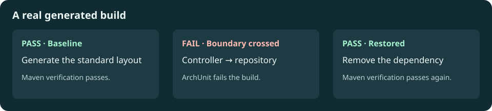

# Codegen Blueprint

**Architecture as an Executable Contract.** Generate a Java and Maven Spring Boot project with architecture rules already wired into its build. When a change crosses a covered boundary, ArchUnit identifies the dependency and Maven fails the build.

**Generate → Enforce → Prove**

[Generate your first project](docs/quickstart.md) · [See a real build fail](docs/demo/executable-architecture-proof.md) · [Compatibility](docs/compatibility.md)

Pick **standard** for a layered project or **hexagonal** for ports and adapters. Guardrails default to `basic`. Choose `strict` to enforce additional boundaries, or `none` to omit ArchUnit.

The 2.0 development build runs on **Java 21 or 25** and targets **Boot 4.1 or 4.2** with **Java 21 or 25**. It defaults to **Boot 4.2 / Java 25**. The quickstart uses the snapshot JAR built from this checkout. Published binaries and their own documentation remain available on [GitHub Releases](https://github.com/blueprint-platform/codegen-blueprint/releases).

| I want to… | Start here |
| --- | --- |
| Generate and verify a project | [Quickstart](docs/quickstart.md) |
| Look up flags or troubleshoot patch resolution | [CLI reference](docs/cli.md) |
| Understand the guarantees and rule coverage | [Architecture contract](docs/architecture/executable-architecture-contract.md) · [Guardrails rulebook](docs/architecture/architecture-guardrails-rulebook.md) |
| Move from 1.x or evaluate 2.0 | [Migration guide](docs/guides/migrate-to-2.0.md) · [Release notes](docs/releases/2.0.0.md) |
| Work on the generator | [Contributing](CONTRIBUTING.md) · [Security](SECURITY.md) |

[Documentation index](docs/index.md) · [MIT license](LICENSE)
