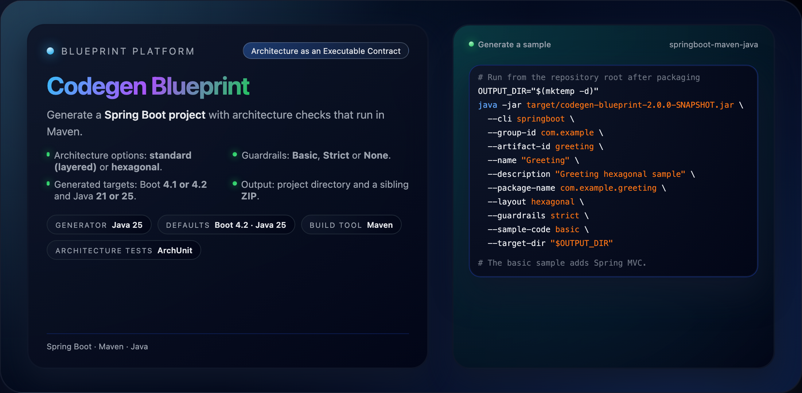
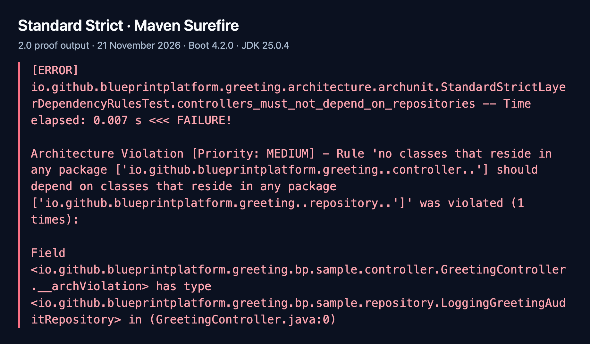

# Codegen Blueprint — Architecture-First Project Generator

[](https://github.com/blueprint-platform/codegen-blueprint/actions/workflows/build.yml?query=branch%3Amain) [](https://app.codecov.io/gh/blueprint-platform/codegen-blueprint/tree/main) [](LICENSE)

<p align="center">
  
</p>

> **Architecture as an Executable Contract.** Codegen Blueprint delivers a Spring Boot Maven project and a sibling ZIP. The generated project's build evaluates the architecture rules you selected.

## Why Codegen Blueprint exists

A codebase starts with clean seams. Then a controller calls a repository to save a trip through the service, a transport DTO imports a domain object, or a package rename leaves a rule selecting nothing. The application can still compile and answer requests. The architecture diagram and the source code have already diverged.

Scaffolding gives the team a starting structure. Executable architecture gives the team a way to check that structure on the next change and every build after it. Codegen Blueprint ships the selected package layout, working sample when requested, and versioned ArchUnit tests together. The generated project can run those tests independently of the generator. A reviewer gets the specific dependency and rule behind a failed build while the change is still easy to understand.

This is designed for Java teams establishing a new service, architects making boundary decisions reviewable, and platform engineers who want a repeatable starting point across teams. Evaluate the supported layouts against your own policy if you are integrating a legacy codebase or need custom organization-wide rules. Production security, observability and other cross-cutting behavior belong to the consuming team or its shared platform libraries. [Scope and ownership](docs/policies/scope-and-responsibility.md)

## 🧪 Executable architecture proof

A generated **Standard** project with **Strict** guardrails passed Maven verification on JDK **25.0.4** using Spring Boot **4.2.0**. The proof added an import for the existing repository and this field to `GreetingController`:

```java
private LoggingGreetingAuditRepository __archViolation = null;
```

The compiler accepted it. Surefire evaluated the compiled class and reported `controllers_must_not_depend_on_repositories`:



Removing the import and field restored the passing build. The proof also exercises a package rename, Hexagonal port bypass and a domain type exposed in an MVC signature in both layouts. [Replay GREEN → RED → GREEN and inspect the build output](docs/examples/boundary-proof.md).

## ⚡ Generate and verify a project

This branch builds **2.0.0-SNAPSHOT**. From the repository root, run the following with **JDK 25** and **Maven 3.9.16**:

```bash
mvn -B -ntp clean package
```

The [quickstart](docs/quickstart.md) runs the packaged JAR, generates the Hexagonal greeting sample with Strict guardrails and runs the generated wrapper. You can inspect two independent signals from the same build: ArchUnit checks in Surefire and HTTP integration checks against a running server in Failsafe.

The generator itself runs on Java **25** with Spring Boot **4.2.0**. Generated projects independently target Boot **4.1 or 4.2** and Java **21 or 25**. The defaults are Boot **4.2** and Java **25**. The CLI resolves and pins an exact parent patch, and reports when a connection failure requires a bundled reference. [CLI reference](docs/cli.md) · [Compatibility and evidence](docs/compatibility.md)

## 🧱 Choose the boundary your team will maintain

| Layout | Source structure | When it fits |
| --- | --- | --- |
| **Standard** (default) | Controllers map HTTP, services orchestrate, repositories handle side effects, and domain types hold business rules. | The team wants a familiar Spring layering model with a check against service bypass and upward dependencies. |
| **Hexagonal** | Inbound adapters call input ports. Use cases call output ports. Outbound adapters implement those ports and bootstrap composes the application. | The team wants explicit use-case APIs and control over how infrastructure dependencies reach the core. |

**Basic** is the default. It checks core dependency directions, context-root cycles and the package schema that makes rules discoverable. **Strict** keeps those protections and adds layout-specific isolation, narrower cycle checks and MVC signature checks when MVC is present. **None** emits the layout without generated architecture tests. [Layout diagrams and dependency directions](docs/architecture/executable-architecture-contract.md#choose-a-layout) · [Named rules and their scope](docs/architecture/architecture-guardrails-rulebook.md)

## 🔌 Follow the contract through the engine

The generator itself uses Hexagonal Architecture. Picocli maps options to an application input port. The use case validates the request and coordinates target resolution, artifact generation and publication. The domain owns the blueprint and its compatibility constraints. Adapters implement Central access, rendering and filesystem operations. Spring wiring and artifact bindings live in bootstrap.

Engine tests check these boundaries and the generation use case. Separate CI jobs take the packaged JAR, generate projects and run the wrappers on the target JDKs. The named violation and recovery runs check that the emitted rules can actually reject a dependency. [Engine walkthrough](docs/guides/how-to-explore-hexagonal-architecture.md) · [Release verification](docs/maintainers/release-discipline.md)

## 📚 Explore the contract

- [Documentation index](docs/index.md) offers paths for evaluating the proof, building a project and maintaining the generator.
- [Generated README examples](docs/examples/generated-projects.md) show the onboarding material shipped inside both layouts.
- [Executable architecture contract](docs/architecture/executable-architecture-contract.md) defines the delivered artifacts, build checks and reproducibility boundary.
- [2.0 release notes](docs/release-notes.md) explain the upgrade from 1.x, which already shipped executable guardrails.

[Contributing](CONTRIBUTING.md) · [Report an issue or share a use case](https://github.com/blueprint-platform/codegen-blueprint/issues) · [MIT license](LICENSE)
