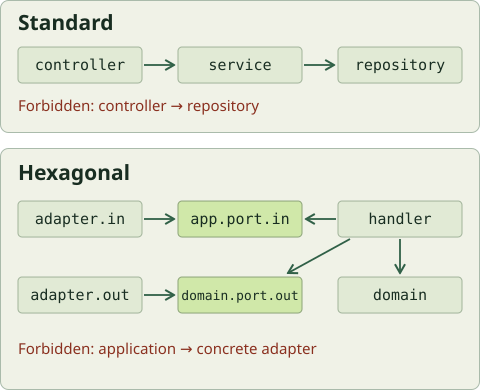

# Guardrails rulebook

Use this reference when choosing a mode or investigating a failing generated architecture test. Each rule name below is a generated Java field or method that can appear in a Surefire report. The source of truth is the [governance template tree](../../src/main/resources/templates/springboot/java/governance).

## Mode selection

| Mode | Generated POM | Generated architecture tests |
| --- | --- | --- |
| `none` | No generated ArchUnit dependency or version property | No ArchUnit sources. The layout and optional sample still build. |
| `basic` (default) | `com.tngtech.archunit:archunit-junit6` in test scope | Layout dependency rules, context-root cycles, scope, schema and anchor checks |
| `strict` | Same test dependency | Every Basic guarantee plus layout-specific restrictions. The equivalent assertion may live in a different test class. MVC adds the REST signature rule. |

The generator chooses the template family using the layout and mode. Strict REST templates come from the `mvc/` group when the effective dependency plan includes MVC. Explicit `web` and the MVC starter added by the basic sample both activate that group. Strict MVC generation fails if the required template group is missing.



## Standard layered layout

Read arrows as source dependencies. Controllers call application-facing services; services can use repositories and domain services. Repositories can use domain models. Configuration can wire those components. Packages in the examples are relative to the generated base or a recognized feature root.

| Dependency or property | Basic | Strict | Generated assertion or class |
| --- | --- | --- | --- |
| `controller → service → repository` | Permitted | Permitted | Positive sample exercises this path |
| `controller → repository` | Prohibited | Prohibited | `controllers_must_not_depend_on_repositories` |
| `service → controller` | Prohibited | Prohibited | `services_must_not_depend_on_controllers` |
| `repository → controller` | Prohibited | Prohibited | `repositories_must_not_depend_on_controllers` in Basic; combined repository rule in Strict |
| `repository → service` | No direct ban | Prohibited | `repositories_must_not_depend_on_services_or_controllers` |
| `controller → domain.service` | Prohibited | Prohibited | `controllers_must_not_depend_on_domain_services` |
| `domain → controller/service/repository` | Prohibited | Prohibited | Basic direction rule; Strict `StandardStrictDomainPurityTest` also limits domain targets to domain and `java.*` |
| `controller.dto → domain` | No direct ban | Prohibited | `StandardStrictControllerDtoDomainIsolationTest` |
| MVC controller method exposes a domain type in its signature | No signature rule | Prohibited when MVC is enabled | `rest_controllers_must_not_expose_domain_types_in_signatures` |
| Context-root sibling slices | Acyclic | Acyclic | `each_bounded_context_root_must_be_free_of_cycles` |
| Immediate child slices within controller, service, repository, domain and config | No additional slice checks | Acyclic | `StandardStrictPackageCyclesTest` |

Common direction rules live in `StandardBasicArchitectureRulesTest` and `StandardStrictLayerDependencyRulesTest`. Strict permits an ordinary controller to reference a domain model internally for mapping, subject to the separate DTO and REST signature checks. [Standard Basic templates](../../src/main/resources/templates/springboot/java/governance/standard/basic) · [Standard Strict templates](../../src/main/resources/templates/springboot/java/governance/standard/strict)

### Keep presentation out of the service

The fixture introduces a field whose type belongs to `controller`. A type reference alone creates the forbidden bytecode dependency.

```java
package com.example.greeting.service;

class Upward {
    com.example.greeting.controller.Presentation next;
}
```

The Maven build compiles the source, then the named ArchUnit assertion reports the dependency.

```text
StandardStrictLayerDependencyRulesTest.services_must_not_depend_on_controllers
Field <com.example.greeting.service.Upward.next> has type <com.example.greeting.controller.Presentation> in (Upward.java:0)
```

Pass values into the service and map the result at the controller. For context cycles, move wiring into a one-way configuration boundary or extract the shared responsibility. The fixture's `config → service → config` cycle demonstrates why checking only subpackages inside a family leaves a gap.

## Hexagonal ports and adapters

An inbound adapter can call an application port. A use case can call an outbound port, and the concrete outbound adapter implements that port. The source dependency goes from the implementation to the interface. At runtime, the call through the interface reaches the adapter. Bootstrap wires the concrete implementation into the use case.

| Dependency or property | Basic | Strict | Generated assertion or class |
| --- | --- | --- | --- |
| `adapter.in → application.port.in` and `adapter.out → application.port.out` | Permitted | Permitted | Positive generated sample |
| `application → adapter` | Prohibited | Prohibited | `application_must_not_depend_on_adapters` |
| `domain → application/adapter/bootstrap` | Prohibited | Prohibited | `domain_must_not_depend_on_outer_families` in Basic; Strict domain purity encompasses these edges |
| External targets from `domain` | No general framework whitelist | Domain packages and `java.*` | `HexagonalStrictDomainPurityTest` |
| Non-bootstrap code `→ bootstrap` | Prohibited | Prohibited | Basic bootstrap-leaf rule and `HexagonalStrictBootstrapLeafTest` |
| `adapter.in ↔ adapter.out` | No direct ban | Prohibited | `HexagonalStrictAdapterDirectionRulesTest` |
| Adapter `→` non-port application code, including the exact application root | No direct ban | Prohibited | `HexagonalStrictPortsIsolationTest#adapters_must_not_depend_on_application_implementation` |
| Inbound adapter `→ domain.service` or `domain.port.out` | No direct ban | Prohibited | `HexagonalStrictInboundAdapterDomainIsolationTest`, `HexagonalStrictInboundAdapterOutboundPortIsolationTest` |
| Inbound DTO package `→ domain` | No direct ban | Prohibited | `HexagonalStrictInboundDtoDomainIsolationTest` |
| MVC inbound adapter method exposes a domain type in its signature | No signature rule | Prohibited when MVC is enabled | `rest_controllers_must_not_expose_domain_types_in_signatures` |
| Context-root sibling slices | Acyclic | Acyclic | `each_bounded_context_root_must_be_free_of_cycles` |
| Child slices of adapter, application, domain, bootstrap and the two adapter directions | No additional slice checks | Acyclic | `HexagonalStrictPackageCyclesTest` |

The Strict port predicate matches the exact application family and accepts the `application.port` subtree. Port APIs can use domain values. Runtime framework wiring belongs in bootstrap. Framework annotations on application code do not violate the domain-only whitelist. [Hexagonal Basic templates](../../src/main/resources/templates/springboot/java/governance/hexagonal/basic) · [Hexagonal Strict templates](../../src/main/resources/templates/springboot/java/governance/hexagonal/strict)

### Depend on a port from the use case

```java
// application.usecase
final class PlaceOrder {
    private final OrderStore store; // application.port.out.OrderStore

    PlaceOrder(OrderStore store) {
        this.store = store;
    }
}
```

Changing the field to the concrete `adapter.out` class produces an architecture violation in both modes. An outbound adapter implementing `OrderStore` is the intended inverse code dependency. The continuity fixture uses a field `Inward.next` to prove the first direction and `Concrete.next` to prove Strict catches adapter dependencies on the exact `application` package.

## Strict MVC transport boundary

Both layouts generate `rest_controllers_must_not_expose_domain_types_in_signatures` when MVC is effective. It observes methods declared by classes directly annotated with `@RestController` in the Standard controller family or Hexagonal inbound adapter family. It checks return and parameter types, including involved generic raw types. The exact `domain` package and descendants are covered.

```java
@RestController
class OrderController {
    // Fails when Order is a domain type. Expose a transport DTO instead.
    ResponseEntity<List<Order>> orders() {
        return ResponseEntity.ok(List.of());
    }
}
```

The rule works on imported bytecode and its declared type information. Composed annotations, other controller styles, inherited routing arrangements and serialized object graphs require separate evidence. Controllers may map domain objects internally; signature checks concern the declared transport surface.

## Scope, cycles and false greens

- `*GuardrailsScopeSanityTest` requires a nonempty import under the generated base package. Imports exclude test classes.
- `*PackageSchemaSanityTest` infers context roots from canonical package segments. Required families are controller/service/domain for Standard and adapter/application/domain for Hexagonal. It distinguishes a more specific recognized context from its parent.
- `*GuardrailsAnchorDriftTest` checks suspicious near-miss family names when required base anchors are missing. The rename proof also exercises schema sanity. These checks address different failure modes.
- Both modes use the schema's detected roots plus the project base for sibling-slice checks. At each root, `.(*)..` partitions the next package segment. Strict additionally partitions immediate child segments within its declared families. A one-way dependency between features can pass; a cycle crossing a selected partition fails.
- Some rules allow empty selections so a fresh project with unused optional families still passes. Maven package markers express intended structure. Read the actual imported classes and the report before treating a passing rule as coverage of any particular package or endpoint.

These checks intentionally retain the `java.*` namespace policy. A broad `javax.*` exception would admit both JDK and external APIs. Teams extending the rule should test the exact exception they need. The explicit dependency and slice DSL expresses the repository's package policy. ArchUnit's layer and onion DSLs are available when a project's mappings and allowed dependencies fit those models. [ArchUnit guide](https://www.archunit.org/userguide/html/000_Index.html)

## Reproduce and diagnose

Generate with `--layout standard` or `--layout hexagonal` and `--guardrails basic` or `strict`. Run `sh ./mvnw clean verify`. Open the named ArchUnit XML in `target/surefire-reports`. Verify the source and target of the failed dependency before changing a package expression or an empty-selection setting. A compiling boundary mutation, a specific assertion failure, and a restored passing build are stronger evidence than a nonzero Maven exit alone. [Executable proof and continuity fixtures](../examples/boundary-proof.md)
