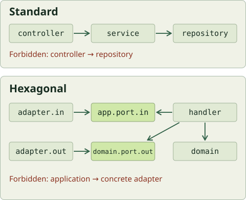

# Executable architecture contract

Codegen Blueprint delivers a Spring Boot Maven project directory and a sibling ZIP. A blueprint selects the project structure, dependency inputs and architecture policy. The generated project runs its own tests and owns its later lifecycle.

- [From blueprint to build](#from-blueprint-to-build)
- [Layout dependencies](#choose-a-layout)
- [What the evidence means](#what-the-evidence-means)
- [Delivery and reproducibility](#delivery-and-reproducibility)

## From blueprint to build

The CLI maps options to a generation command. The application validates the request, chooses a profile and resolves the target through a port. It then coordinates rendering and publication. The generated source tree, POM, wrapper and selected tests capture those decisions.

Run `sh ./mvnw clean verify` inside the generated project. Surefire runs ArchUnit against the compiled classes and writes XML under `target/surefire-reports/`. If the sample is enabled, Failsafe runs separate integration tests, including real HTTP. The [quickstart](../quickstart.md) shows both report locations.

The domain defines target compatibility and requires a resolved target in the blueprint. The selected generation profile checks its metadata constraints before the resolver can access the network. The Spring Boot outbound adapter owns Central lookup and bundled fallback, with references supplied by bootstrap. The CLI maps the generic resolution source to its public labels and renders fallback warnings from message keys.

Bootstrap validates artifact order and fixed template definitions at startup. The sample and guardrails adapters select and scan templates for the requested layout and mode during generation.

Engine ArchUnit tests enforce the application dependency boundary. Use case and CLI integration tests check that invalid metadata stops before resolution, and adapter tests verify which lookup failures permit fallback.

## Choose a layout

Arrows in the diagram point from dependent code to the code it references. The red lines of text identify selected dependencies that both Basic and Strict prohibit.

In **Standard**, each feature uses layered packages, with component wiring in configuration. This follows [Fowler’s presentation, domain and data layering](https://martinfowler.com/bliki/PresentationDomainDataLayering.html).

In **Hexagonal**, a use case calls an outbound port at runtime. The driven adapter implements that port and depends on its interface in source code; bootstrap wires the implementation into the use case. This follows [Cockburn’s Ports and Adapters](https://alistair.cockburn.us/hexagonal-architecture/).

The [guardrails rulebook](architecture-guardrails-rulebook.md) defines what each mode enforces. Strict retains Basic guarantees and may report a violation under a different assertion.

## What the evidence means

ArchUnit inspects compiled types imported from the generated base package and applies each rule's selectors. A field type, implemented interface or method signature can create a dependency even if the code never runs. Test classes are excluded from the architecture import. The generated rules allow selected optional scopes to be absent, so an unused adapter family or an application without MVC can still build. Package names organize the check; they alone provide no evidence that every business class was imported or correctly classified. [ArchUnit JUnit and import guide](https://www.archunit.org/userguide/html/000_Index.html)

A passing architecture test establishes the named constraint on the selected bytecode. The [boundary proof](../examples/boundary-proof.md) shows the corresponding evidence for a failure and recovery. Application correctness, dynamic wiring and runtime security need their own evidence. The consumer owns application code, dependency updates, deployment and any added architecture policies.

## Delivery and reproducibility

Use [compatibility](../compatibility.md) and the [CLI reference](../cli.md) for generator JVMs, target JDKs and Boot patch selection. With the same generator, normalized inputs and resolved patch, generation preserves the project tree and file contents. ZIP byte identity has no guarantee.

Generation protects existing outputs and attempts to clean up owned paths on normal failures. The publisher uses a private staging directory and claims the destination directory, files and ZIP without overwriting existing entries. If filesystem identity is missing or changes, staging verification fails or rollback leaves the uncertain path in place. Keep the target and staging tree free from concurrent edits. Portable path operations leave a race between identity checks and access. The final directory and ZIP may be visible before publication finishes. A process interruption or crash can leave either output incomplete.
