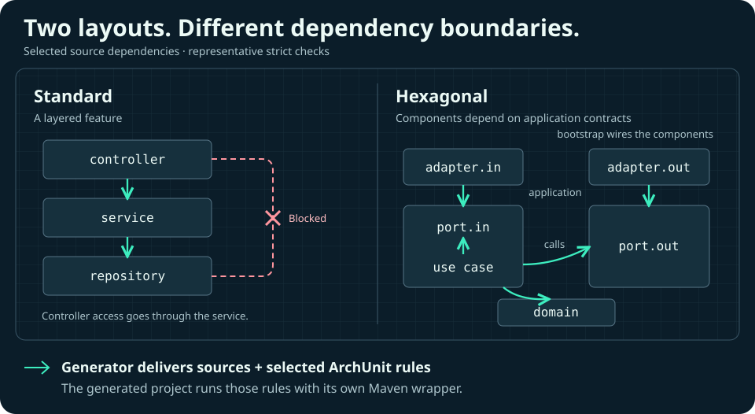

# Executable architecture contract

Codegen Blueprint delivers a Spring Boot Maven project directory and a sibling ZIP. A blueprint selects the project structure, dependency inputs and architecture policy. The generated project runs its own tests and owns its later lifecycle.

## Generate, enforce, prove

| Stage | Responsible component | Observable evidence |
| --- | --- | --- |
| Generate | The CLI validates the blueprint, resolves an exact Boot patch and renders the ordered profile artifacts. | Generated source tree, POM, wrapper and selected test sources. |
| Enforce | The consumer runs `sh ./mvnw clean verify`. Maven compiles classes and Surefire executes generated ArchUnit assertions. | Surefire XML under `target/surefire-reports`. The optional sample executes separate Failsafe integration tests, including HTTP. |
| Prove | A compiling source change crosses a known dependency boundary. The same command runs before the change, with the change, and after restoration. | Passing baseline, named rule and concrete edge in a failing test report, then a passing rebuild. |

The tests travel with the generated project. After generation, Maven can enforce the architecture with the delivered wrapper and dependencies. Follow the [quickstart](../quickstart.md) for the commands and the [proof](../examples/boundary-proof.md) to observe a named failure.

## Choose a layout

**Standard** gives each feature controller, service, repository and domain families. A controller can delegate to a service, which can access a repository. A service dependency on its controller inverts that boundary. Configuration can wire components. This layout fits projects that benefit from explicit layers and direct repository calls from services. [Fowler's presentation, domain and data layering](https://martinfowler.com/bliki/PresentationDomainDataLayering.html)

**Hexagonal** makes the application's ports explicit. Driving adapters use an inbound port. Use cases can require outbound capabilities through an outbound port. Driven adapters implement those capabilities, and bootstrap wires implementation to port. The diagram shows source dependencies, so an outbound adapter's arrow points toward the port even when a use case calls it at runtime. The project uses particular package families to make these relationships checkable. [Cockburn's Ports and Adapters](https://alistair.cockburn.us/hexagonal-architecture/)

## Choose enforcement depth

- **None** delivers structure and any requested sample with no generated ArchUnit dependency or tests.
- **Basic** is the default. It enforces the layout's core dependency directions and sibling-slice acyclicity. Scope, schema and anchor checks protect the package assumptions.
- **Strict** retains those guarantees and adds stricter package relationships, domain purity, DTO boundaries and finer cycle checks. If MVC is present, it also checks covered REST signatures.

Moving from Basic to Strict can expose additional violations. A Basic failure must still fail in Strict, even if Strict reports it through another assertion. The [rulebook](architecture-guardrails-rulebook.md) maps each defined guarantee to its generated test.

## What the evidence means

ArchUnit inspects compiled types imported from the generated base package and applies each rule's selectors. A field type, implemented interface or method signature can create a dependency even if the code never runs. Test classes are excluded from the architecture import. The generated rules allow selected optional scopes to be absent, so an unused adapter family or an application without MVC can still build. Package names organize the check; they alone provide no evidence that every business class was imported or correctly classified. [ArchUnit JUnit and import guide](https://www.archunit.org/userguide/html/000_Index.html)

The sample HTTP integration tests prove the delivered sample can respond through its supported runtime path. Architecture tests prove the specified structural assertions on their selected bytecode. Application correctness, dynamic wiring and runtime security need their own evidence. The consumer owns application code, dependency updates, deployment and any added architecture policies.

## Delivery and reproducibility

Use [compatibility](../compatibility.md) and the [CLI reference](../cli.md) for generator JVMs, target JDKs and Boot patch selection. With the same generator, normalized inputs and resolved patch, generation preserves the project tree and file contents. ZIP byte identity has no guarantee.

Generation protects existing outputs and attempts to clean up owned paths on normal failures. If the filesystem cannot identify the staging directory, generation reports its retained path and fails. Rollback leaves outputs with uncertain identity in place and reports them. Keep the target and private staging directory free from concurrent edits. Portable filesystem operations leave a race between identity checks and access. Directory and ZIP publication are separate operations and have no joint atomicity guarantee on interruption or crash.
