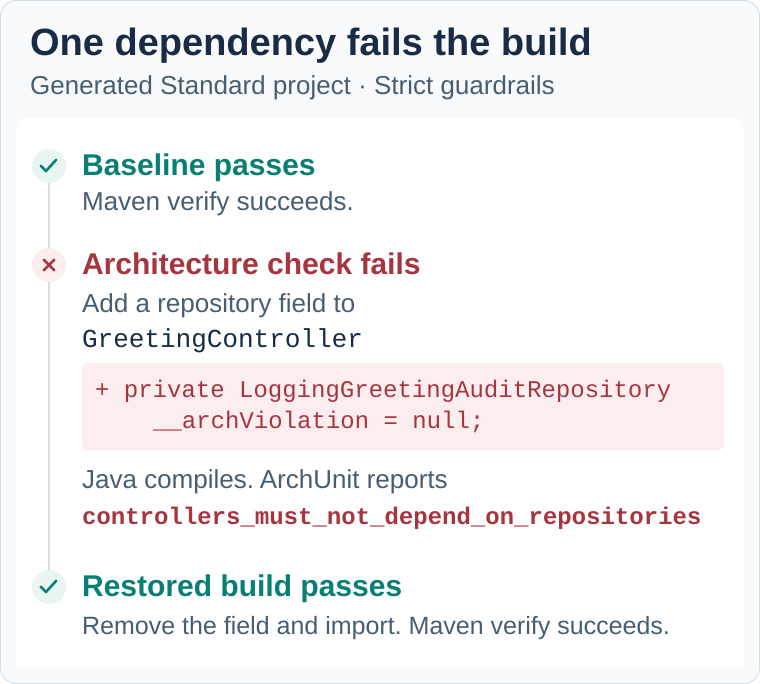

# Executable architecture proof

The proof starts from two generated Spring Boot projects. It runs Maven verification, introduces one compilable boundary violation at a time, checks the failing ArchUnit rule, restores the change and verifies again.



## Run the proof

Build and run the generator with JDK 25. The proof targets Java 25 by default, so its generated Maven builds need JDK 25. The wrapper uses `JAVA_HOME` when set, otherwise it uses `PATH`. On macOS, select an installed JDK 25 for this invocation with `JAVA_HOME="$(/usr/libexec/java_home -v 25)"`.

```bash
mvn -B -ntp clean package
CODEGEN_JAR="$PWD/target/codegen-blueprint-2.0.0-SNAPSHOT.jar" \
  bash ci/proof/proof-runner.sh
```

To verify Java 21 projects on JDK 21, set `JAVA_VERSION=21`, point `JAVA_HOME` at JDK 21 and set `GENERATOR_JAVA` to the absolute path of the JDK 25 `java` executable. The generator and the generated Maven builds then run on their respective JDKs. The continuity fixture below also accepts `GENERATOR_JAVA`.

The runner prints its evidence directory under `target/architecture-proof/`. Set `PROOF_OUTPUT_ROOT` for another location. To reproduce the bundled-reference test run, set `EXPECT_BOOT_SOURCE=BUNDLED_FALLBACK`. That proof-only setting blocks the generator’s Central connection and checks the source reported by the CLI. The generated Maven build still needs access to dependencies.

## Recorded 2.0 result

The Java 25 / Boot 4.2 run passed both baselines, detected all five violations and passed each restored build. The recorded checkout produced a snapshot artifact. Its hash and the named assertions are available in the [portable proof record](proof-2.0.txt).

| Change introduced | Rule family that must fail |
| --- | --- |
| Hexagonal adapter depends on an application implementation | Ports isolation |
| Standard controller package renamed to a near-miss family | Package schema sanity |
| Standard controller depends on a repository | Layer dependency |
| Hexagonal MVC controller exposes a root-domain type inside a generic response | REST signature isolation |
| Standard MVC controller exposes a root-domain type inside a generic response | REST signature isolation |

The harness requires the named failure in the ArchUnit report and log. A compilation, download or unrelated test failure fails the proof itself. The REST cases rely on MVC added by the sample, exercising the generated guardrail without an explicit `web` alias.

See [compatibility](../compatibility.md#verification-coverage) for the broader matrix and the [rulebook](../architecture/architecture-guardrails-rulebook.md) for scope.

## Prove that Strict keeps the Basic boundaries

Run the continuity fixtures against the same packaged JAR. Use a fresh output path. The harness uses the bundled Boot patch and validates generated builds through the wrapper. Its green phases require the real sample HTTP report and architecture reports. Its red phases require each named assertion plus the fixture type in the Surefire failure.

```bash
python3 ci/proof/guardrail-continuity.py \
  target/codegen-blueprint-2.0.0-SNAPSHOT.jar target/guardrail-continuity \
  --boot 4.2 --java 25
```

| Fixture | Basic evidence | Strict evidence |
| --- | --- | --- |
| Standard service type references a controller | Service dependency assertion | Same service assertion |
| Standard `config ↔ service` cycle | Context-root cycle assertion | Same context-root cycle assertion alongside family-internal checks |
| Hexagonal application use case references a concrete adapter | Application direction assertion | Same application assertion |
| Hexagonal domain model references an adapter | Domain direction assertion | Domain purity assertion |
| Hexagonal application and adapter form a cycle | Context-root cycle assertion | Same context-root cycle assertion |
| Hexagonal adapter references a class directly in `application` | No separate port rule | Adapter implementation-isolation assertion |

The previous Strict templates accepted two compiling counterexamples under Boot 4.2 and Java 25: the Standard context-root cycle and the Hexagonal application-to-adapter edge. With the revised templates, the four continuity projects passed before mutation, reported all applicable assertions after mutation, and passed again after source restoration. The Standard cycle was reported as `Cycle detected: Slice config`; the Hexagonal application edge identified `Inward.next` referencing `adapter.out.Concrete`. The same four fixtures passed on Boot 4.1.3 / Java 21 and Boot 4.2.0 / Java 25 with bundled resolution.

The separate REST proof puts the probe type directly in `domain` and exposes it through `ResponseEntity<List<…>>` on a directly annotated controller. This exercises generic signature scanning and the exact package-root boundary in both layouts.
