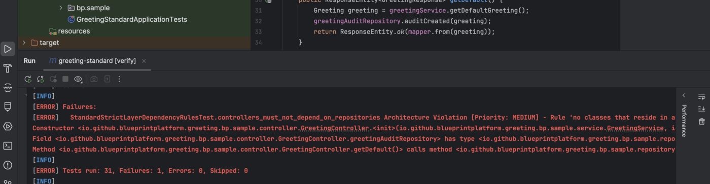

# Executable architecture proof

The proof runner verifies a **GREEN → RED → GREEN** sequence for generated projects with Strict guardrails. The baseline passes, a compiling mutation fails at a named ArchUnit rule, and the build passes after source restoration. Every phase uses `sh ./mvnw -q -ntp clean verify`. A passing sample build also exercises HTTP through Failsafe. The architecture assertion inspects compiled code during Surefire.

- [Walk through the controller-to-repository case](#standard-controller-depends-on-a-repository)
- [Compare all five recorded scenarios](#recorded-results)
- [Run the proof](#run-the-proof)
- [Inspect the generated evidence](#inspect-a-run)
- [Check Basic and Strict continuity](#prove-that-strict-keeps-the-basic-boundaries)

## Standard controller depends on a repository

### Green · verify the generated baseline

The generated controller delegates to `GreetingService`. The service holds the audit repository interface and decides when to call it. The runner verifies the unmodified project with the wrapper before changing any source.

### Red · add one dependency and identify the failing test

In `bp.sample.controller.GreetingController`, the runner inserts this import:

```java
import io.github.blueprintplatform.greeting.bp.sample.repository.LoggingGreetingAuditRepository;
```

It then adds a field inside the class body. The field's declared type is enough to create a bytecode dependency. No call, bean wiring or HTTP request is required to expose that edge.

```java
private LoggingGreetingAuditRepository __archViolation = null;
```


The excerpt below comes from `logs/STD_violation.log`. The runner accepts the red result only when the build log identifies the failed assertion and the corresponding Surefire XML contains a failure.

```text
[ERROR] io.github.blueprintplatform.greeting.architecture.archunit.StandardStrictLayerDependencyRulesTest.controllers_must_not_depend_on_repositories -- Time elapsed: 0.007 s <<< FAILURE!
Field <io.github.blueprintplatform.greeting.bp.sample.controller.GreetingController.__archViolation> has type <io.github.blueprintplatform.greeting.bp.sample.repository.LoggingGreetingAuditRepository> in (GreetingController.java:0)
```

[View the original rendered 2.0 Surefire excerpt](../images/architecture/standard-strict-proof.png).

### Green · restore the source and rerun the same build

The runner removes the field and import and runs the same verification again. The passing result is evidence that the source restoration was sufficient with the generated test still enabled.

### What to look for in the other mutations

**Hexagonal port bypass.** The greeting controller normally references `GetGreetingPort`. The runner imports `bp.sample.application.usecase.GetGreetingHandler` and adds `private GetGreetingHandler __archViolation = null;`. The concrete class is on the classpath and the change compiles. The rule rejects that field because an adapter now knows the use-case implementation. Bootstrap can still use the concrete handler to assemble the application.

**Standard schema drift.** The runner moves the base `controller` directory to `controllers` and updates the package declaration. The greeting sample still has its own canonical families under `bp.sample`. The base rename is a separate case: the emitted schema check reports the missing canonical controller family. This proof protects rule discovery even when the compiler accepts the new package name.

**REST transport leakage.** The runner adds a domain record named `GuardrailsDomainProbe` and a directly annotated `@RestController` beside the sample controller. Its method declares:

```java
public ResponseEntity<List<GuardrailsDomainProbe>> leaksDomainType() {
    return null;
}
```

The declared type is enough. The assertion inspects the generic signature in compiled bytecode and reports the domain type in both layouts. No HTTP request to the probe is required. Removing the two added source files restores the original transport surface.

## Recorded results

All five mutations compiled before failing their named architecture rule, and each restored project passed verification. The baseline, violation and restoration stages are recorded for every case.

| Layout | Mutation | Assertion |
| --- | --- | --- |
| Standard | Canonical controller package renamed | `StandardPackageSchemaSanityTest#each_standard_bounded_context_must_contain_required_canonical_families` |
| Standard | Controller field references repository | `StandardStrictLayerDependencyRulesTest#controllers_must_not_depend_on_repositories` |
| Standard | MVC signature exposes a domain type | `StandardStrictRestBoundarySignatureIsolationTest#rest_controllers_must_not_expose_domain_types_in_signatures` |
| Hexagonal | Inbound adapter field references application implementation | `HexagonalStrictPortsIsolationTest#adapters_must_not_depend_on_application_implementation` |
| Hexagonal | MVC signature exposes a domain type | `HexagonalStrictRestBoundarySignatureIsolationTest#rest_controllers_must_not_expose_domain_types_in_signatures` |

Both REST cases use MVC enabled by the sample and a domain type nested in `ResponseEntity<List<…>>`. The runner checks the Surefire failure report and the named assertion in the Maven log before accepting a failure.

The original 2.0 run recorded on **21 November 2026** used JDK **25.0.4**, Maven **3.9.16** and Spring Boot **4.2.0** via `BUNDLED_FALLBACK`. The [original verification record](boundary-verification.txt) contains the generator JAR’s SHA-256, the full test class names and the logged field dependency.

The documentation restoration replayed all five cases locally with the same JDK, Maven and Boot patch. The [replay record](boundary-verification-restoration.txt) identifies the independently packaged JAR and all baseline, failure and restoration verdicts.

### Historical terminal capture

This screenshot from the 1.x walkthrough shows the same Standard dependency rule in the earlier release. The 2.0 terminal excerpt and replay above establish the current result.



## Run the proof

From the repository root, use JDK 25 and Maven 3.9.16. On macOS, select an installed JDK 25 with `export JAVA_HOME="$(/usr/libexec/java_home -v 25)"`.

```bash
mvn -B -ntp clean package
```

Run the controller-to-repository case.

```bash
PROOF_MODE=standard bash ci/proof/proof-runner.sh
```

To reproduce the bundled-reference run, run all five cases with the bundled Boot patch.

```bash
PROOF_MODE=full BOOT_VERSION=4.2 JAVA_VERSION=25 \
  EXPECT_BOOT_SOURCE=BUNDLED_FALLBACK bash ci/proof/proof-runner.sh
```

`EXPECT_BOOT_SOURCE=BUNDLED_FALLBACK` blocks the generator’s Central connection for the proof and verifies the reported resolution source. The generated Maven build still needs access to dependencies. To reuse a packaged generator, pass its absolute path as `CODEGEN_JAR`. To target Java 21, set `JAVA_VERSION=21`, point `JAVA_HOME` at JDK 21 and set `GENERATOR_JAVA` to the absolute path of the JDK 25 `java` executable.

## Inspect a run

Open the run directory printed by the runner under `target/architecture-proof/`.

| Artifact | What to check |
| --- | --- |
| `proof-summary.txt` | Baseline, expected failure and restoration verdicts |
| `logs/` | Maven output for each phase |
| `env.txt` | JDK, Maven, generator and run context |
| `excerpts/` | Named assertion and the logged dependency for each expected failure |

Set `KEEP_WORK_DIR=1` before running to retain the restored generated projects for source and report inspection. The final `clean verify` replaces the project’s red XML reports. Read the saved log and excerpt for the failing phase. The proof runner also accepts `PROOF_OUTPUT_ROOT` for a different output location.

After a successful full run, replace `RUN_DIRECTORY` with the printed run directory name to produce a portable record:

```bash
python3 scripts/proof-record.py "target/architecture-proof/RUN_DIRECTORY"
```

See [compatibility](../compatibility.md#verification-coverage) for the broader matrix and the [rulebook](../architecture/architecture-guardrails-rulebook.md) for rule scope.

## Prove that Strict keeps the Basic boundaries

Run the continuity fixtures against the same packaged JAR. Use a fresh output path. The harness uses the bundled Boot patch and validates generated builds through the wrapper. Its green phases require the real sample HTTP report and architecture reports. Its red phases require each named assertion plus the fixture type in the Surefire failure.

```bash
python3 ci/proof/guardrail-continuity.py \
  target/codegen-blueprint-2.0.0-SNAPSHOT.jar target/guardrail-continuity \
  --boot 4.2 --java 25
```

| Fixture | Basic evidence | Strict evidence |
| --- | --- | --- |
| Standard service type references a controller | Service dependency assertion | Same service assertion |
| Standard `config ↔ service` cycle | Context-root cycle assertion | Same context-root cycle assertion alongside family-internal checks |
| Hexagonal application use case references a concrete adapter | Application direction assertion | Same application assertion |
| Hexagonal domain model references an adapter | Domain direction assertion | Domain purity assertion |
| Hexagonal application and adapter form a cycle | Context-root cycle assertion | Same context-root cycle assertion |
| Hexagonal adapter references a class directly in `application` | No separate port rule | Adapter implementation-isolation assertion |

The previous Strict templates accepted two compiling counterexamples under Boot 4.2 and Java 25: the Standard context-root cycle and the Hexagonal application-to-adapter edge. With the revised templates, the four continuity projects passed before mutation, reported all applicable assertions after mutation, and passed again after source restoration. The Standard cycle was reported as `Cycle detected: Slice config`; the Hexagonal application edge identified `Inward.next` referencing `adapter.out.Concrete`. The same four fixtures passed on Boot 4.1.3 / Java 21 and Boot 4.2.0 / Java 25 with bundled resolution.
