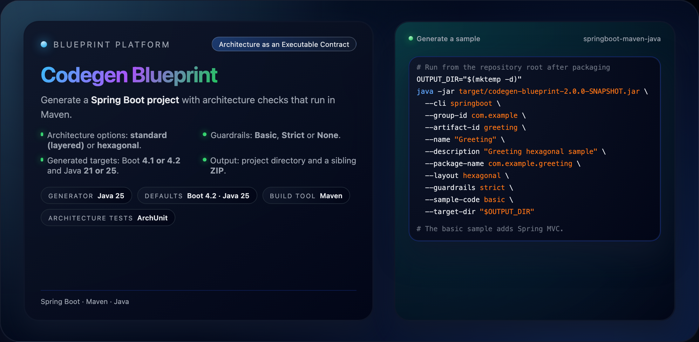
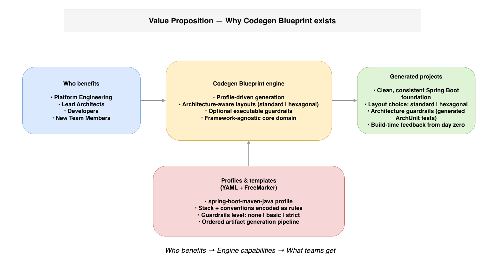

# Codegen Blueprint documentation

Architecture can drift while a service still compiles and answers requests. Codegen Blueprint generates a Spring Boot project whose Maven build can flag that drift at the selected boundaries.

Start with a single failed assertion to evaluate the claim, or build a working sample and follow its dependencies from the HTTP boundary into the domain.

## See the build enforce a boundary

- [Executable architecture proof](examples/boundary-proof.md) walks through a compiling Java change, the named ArchUnit failure and the passing build after restoration.
- [Architecture contract](architecture/executable-architecture-contract.md) explains the generated output and shows the dependency directions in both layouts.
- [Explore the generator's Hexagonal Architecture](guides/how-to-explore-hexagonal-architecture.md) follows a CLI request through the use case, ports and adapters.
- [Scope and responsibility](policies/scope-and-responsibility.md) explains what a green build establishes and what the consuming application owns.
- [Guardrails rulebook](architecture/architecture-guardrails-rulebook.md) maps Basic and Strict to their exact assertions.

## Generate and verify a project

- [Quickstart](quickstart.md) generates a Hexagonal project and verifies it with its Maven wrapper.
- [Generated project walkthroughs](examples/generated-projects.md) show the actual Standard and Hexagonal README output.
- [CLI reference](cli.md) covers selectors, dependency aliases, version resolution and failures.

## Choose a target or plan an upgrade

- [Compatibility](compatibility.md) lists supported Boot and Java pairs and their verification coverage.
- [2.0 release notes](release-notes.md) describe the changes from 1.x.

## Maintain the repository

- [Contributing](../CONTRIBUTING.md) covers development and review expectations.
- [Release readiness](maintainers/release-discipline.md) describes the CI matrices and release gates.
- [Architecture governance](maintainers/architecture-governance-and-ai-protocol.md) records who owns contract decisions and what makes a change reviewable.
- [Visual assets](maintainers/visual-assets.md) tracks the cover, diagrams and proof presentation.
- [Documentation tooling](maintainers/documentation.md) covers Pages previews and generated snapshot checks.
